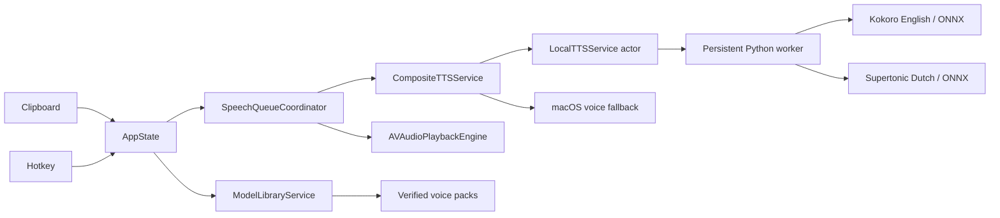

# SoundPloeg architecture

## Model packs

`Config/model_catalog.json` and its bundled copy contain two pinned packs.
Each pack has shared engine assets, voice descriptors, immutable download URLs,
file sizes, and SHA-256 hashes. `installed.json` is written only after every
asset has passed verification. The app exposes voices only when that receipt
matches the catalog and all required files have the expected size.

Downloads go to a staging directory, followed by an atomic directory move or
replacement. Removal acts on the complete pack. The UI maps voice IDs back to
pack IDs so selecting and removing multi-voice packs remains consistent.
Bootstrap migrates away from known Piper files after the new packs install.

## Speech worker

`LocalTTSService` sends one JSON request at a time over pipes to the bundled
`Runtime/tts_worker.py`. There is no HTTP server. The Python environment lives
in Application Support under `tts-venv`. Each engine loads on first use and
remains resident until Stop, Skip, a timeout, a worker crash, or app shutdown.

Responses carry request IDs. Errors include their cause. Swift bounds response
buffers, consumes stderr independently, and uses a 90-second request timeout.
Cancellation terminates the worker and resumes the waiting Swift request with
`CancellationError`. A later request creates a fresh worker. Cancellation never
activates system voice fallback.

## Queue and playback

The queue preserves punctuation and splits long text at sentence or word
boundaries, with a maximum of 280 characters per chunk. It prepares one next
chunk during playback. Stop/Skip cancel generation as well as playback; stale
output is discarded. Pause during generation holds the audio until resumed.

Playback reconnects the audio node with the WAV's actual format, supporting
Kokoro's 24 kHz and Supertonic's 44.1 kHz. Completion uses `dataPlayedBack`, and
playback IDs prevent callbacks from stopped audio from completing a newer job.
Temporary chunk files are removed after playback. Single-chunk output is copied
to history before its temporary file is removed.

## Validation

Swift tests cover queue interruption, punctuation, fallback, model checksums,
resource packaging, worker reuse, crash recovery, timeout, and cancellation.
An opt-in integration test runs the bundled worker through `LocalTTSService`
with both real engines. `Scripts/smoke_tts.py` exercises all six voices twice
and checks non-empty, finite PCM output, sample rate, duration, and latency.
